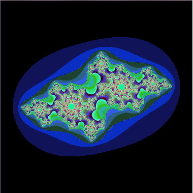

*This project has been created as part of the 42 curriculum by hhurnik.*

# fractol

## Description

fractol is an interactive fractal explorer written in C using MiniLibX.

The program renders the Mandelbrot and Julia sets by applying complex-number calculations to each pixel and mapping the number of iterations to colors.

The project focuses on computer graphics, complex numbers, coordinate transformations, image rendering and event handling.

## Preview

<p align="center">
  
</p>

<p align="center">
  Julia set animation using parameters <code>-0.70176 -0.3842</code>.
</p>

## Features

- Mandelbrot set rendering
- Julia set rendering with custom parameters
- interactive zoom using the mouse wheel
- view navigation using the arrow keys
- adjustable iteration limit using `,` and `.`
- iteration-based color rendering
- clean window handling with `ESC` and the window close button

## Controls

| Input | Action |
|---|---|
| Mouse wheel | Zoom in / out |
| Arrow keys | Move around the fractal |
| `.` | Increase iteration limit |
| `,` | Decrease iteration limit |
| `ESC` | Close the program |

## Build

Clone the repository:

```bash
git clone https://github.com/hhurnik/fractol.git
cd fractol
```

Build the project:

```bash
make
```

This creates the `fractol` executable.

## Usage

### Mandelbrot

```bash
./fractol mandelbrot
```

### Julia

Julia sets can be generated by providing the real and imaginary parts of the complex parameter:

```bash
./fractol julia <real_part> <imaginary_part>
```

For example:

```bash
./fractol julia -0.70176 -0.3842
```

Different parameters generate different Julia sets.

## Example Fractals

Here are a few interesting configurations to explore:

```bash
./fractol mandelbrot
./fractol julia -0.70176 -0.3842
./fractol julia -0.8 0.156
./fractol julia 0.285 0.01
./fractol julia 0 1
```

Each Julia parameter produces a different fractal structure. Zooming into the boundaries reveals increasingly detailed patterns.

## Project Structure

```text
fractol/
├── assets/
│   └── fractol-zoom-pingpong.gif
├── minilibx_linux/
├── events.c
├── fractol.h
├── fractol_main.c
├── handle_strings.c
├── init.c
├── math.c
├── rendering.c
└── Makefile
```
